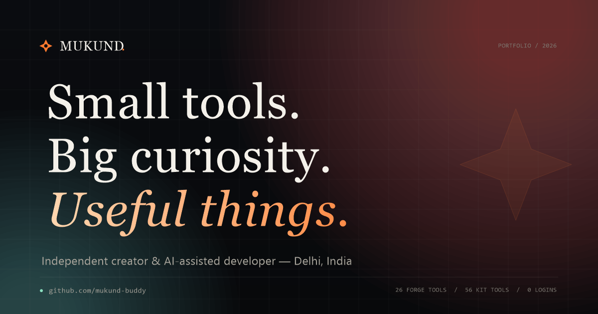

# Mukund — builder, creator, and persistent learner

<p>
  
  
  
  
  
</p>

**The personal portfolio of Mukund — a student, creator, and builder from Delhi.**

I make practical things for the web, mostly with vanilla HTML, CSS, and JavaScript. My main YouTube channel is **Not Gaming Playz**; **Adventigle** is my second channel and community hub. This repository contains the source for my portfolio website.



> Useful beats impressive. Every time.

## What's inside

- **Editorial single-page portfolio** with a dark "Ember & Ink" visual system.
- **Work section** covering AntigleKit, Not Gaming Playz, Adventigle, LANShare, Antigle ToolNest, and Antigle Workspace.
- **Creator section** with Not Gaming Playz (main channel), Adventigle (second channel), and the Adventigle community hub.
- **Aurum Studio design study** — clearly labelled as fictional.
- **About section** with a portrait photo in the identity card.
- **Responsive layout**, reduced-motion support, keyboard-friendly navigation, skip link, and accessible focus states.
- **SEO and social metadata**, including JSON-LD and a 1200 × 630 Open Graph image.
- **No framework, no build step, no runtime dependencies.**

## Tech stack

| Layer | What is used |
| --- | --- |
| Markup | Semantic HTML5 |
| Styling | Modern CSS: custom properties, Grid, Flexbox, `clamp()`, transitions |
| Behaviour | Vanilla JavaScript (ES6+) |
| Type | Fraunces, Inter, and JetBrains Mono via Google Fonts |
| Tooling | None required |

## Project structure

```text
mukund-buddy/
├── index.html
├── 404.html
├── css/
│   └── styles.css
├── js/
│   └── main.js
├── assets/
│   ├── favicon.svg
│   ├── me.png
│   └── og.png
└── README.md
```

## Run locally

No installation or build step is required.

```bash
# Python 3
python -m http.server 4173
```

Then open <http://127.0.0.1:4173/>.

You can also open `index.html` directly in a browser. A local server is recommended so relative paths and browser security behave like a normal static deployment.

## Deploy

This is a static site. Publish the repository root with GitHub Pages, Cloudflare Pages, Netlify, or any static host.

Before deploying to a custom domain:

1. Replace the relative `assets/og.png` social image path with an absolute URL.
2. Add the canonical URL and `og:url` once the final domain is known.
3. Confirm that `assets/me.png` is the portrait you want to publish.

## Channels

| Channel | Role | Link |
| --- | --- | --- |
| Not Gaming Playz | Main YouTube channel | <https://www.youtube.com/@notgamingplayz> |
| Adventigle | Second YouTube channel | <https://www.youtube.com/@adventigle> |
| Adventigle Hub | Community hub and video vault | <https://mukund-buddy.github.io/Adventigle/index.html> |

## Featured projects

| Project | What it is |
| --- | --- |
| [AntigleKit](https://mukund-buddy.github.io/AntigleKit/#/) | A focused toolkit for Minecraft Bedrock creators. |
| [Not Gaming Playz](https://not-gaming-playz.pages.dev/) | Minecraft creator hub for Bedrock tutorials, JSON UI, add-ons, and fixes. |
| [Adventigle](https://mukund-buddy.github.io/Adventigle/index.html) | Community hub for Minecraft PE and Bedrock players. |
| [LANShare](https://github.com/mukund-buddy/lanshare) | Offline file transfer over local Wi-Fi with QR pairing. |
| [Antigle ToolNest](https://antigle-toolnest.pages.dev/) | A growing collection of small, useful static tools. |
| [Aurum Studio](https://github.com/mukund-buddy/aurum-studio) | A fictional design-studio landing page and front-end craft study. |

## Aurum Studio notice

**Aurum Studio is fictional.** It is an independent design study created for inspiration and front-end practice. The studio, clients, projects, testimonials, prices, email addresses, and contact details shown in that project are placeholders. It is not a real company, and nothing in it should be treated as a real commercial claim or a real phone/contact listing.

The Aurum Studio source lives at <https://github.com/mukund-buddy/aurum-studio>.

## Privacy

The deployed site uses `assets/me.png`, the original portrait photo. A copy of the source image is kept outside this repository in `mukund-portfolio-source/me-original.jpg`.

## Contact

- **GitHub:** [@mukund-buddy](https://github.com/mukund-buddy)
- **YouTube (main):** [Not Gaming Playz](https://www.youtube.com/@notgamingplayz)
- **YouTube (second):** [Adventigle](https://www.youtube.com/@adventigle)
- **Email:** [jmukund9625@gmail.com](mailto:jmukund9625@gmail.com)

## License

Personal project. The site content, writing, and branding belong to Mukund. Third-party fonts and assets remain under their respective licenses. The separate Aurum Studio project is released under the MIT License.
